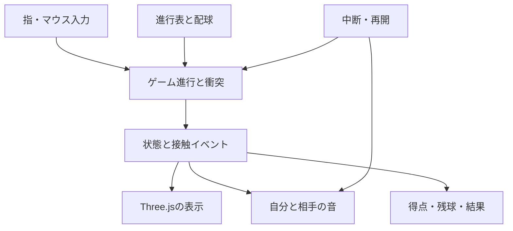

# タッケウ 要件・設計書

作成日：2026-10-22（日本時間）  
対象：`chameleonjp-lab/takkeu`  
調査した基準コミット：`750b7e4da3c12bb7683e7ab44ff6391ecadbc105`  
状態：初回設計を公開後のユーザー指定で改訂した現行要件。実装・検証・公開の状態は `docs/progress.md` と各対象SHAの受入記録で区別する。

> **最新の配球調整と発光照合（2026-10-23）**：ユーザーが了承した球速を維持し、終点だけでなくワンバウンド後の見える軌道を左右へ分散する。相手への往路で左右帯を選び、その打球位置と次の自側目標を同じ帯に配置する。左・右各約40%、中央約20%の候補配分。初回サーブ、飛行時間、加速式、接触判定は維持。部位の発光数値は下表と一致するため変更せず、実加点と境界画像で照合する。報告された発光タイミングの不一致は未再現であり、修正済みとは扱わない。[計画](../plans/2026-10-23-return-spread-glow.md)・[検証記録](../../verification/return-spread-glow/README.md)を参照。

> **最新の速度・後半段階指定（2026-10-23）**：初速を上げ、左右の配球を広げ、飛行中の往復球も毎ラリー加速する。450から全返球がスマッシュ。460の足、470以後2ラリーごとの増球、480の全球発光・再可視、490の相手側全体を継ぎ目のない虹色、500/510のランダムな光、520/530の返球・台面花火、540のスマッシュ増速、555の方向を変えるバウンドを追加する。短い描画遅延は最大0.10秒だけ計算し残りを破棄、1.50秒超の中断は停止する。[設計](2026-10-23-extended-rally-design.md)・[計画](../plans/2026-10-23-extended-rally.md)・[今回の検証](../../verification/extended-rally/README.md)を参照。以下の数表を今回の指示へ更新し、過去の検証記録は保持する。

> **履歴：増球指定（2026-10-23）**：開始1球、5で1球追加して計2球、10で2回目の追加を行い計3球、以後20・30…と10ラリーごとに1球追加する。上限なし・落球補充なし。無落球なら21で4球、450で47球。「10ラリー目で2球目追加」は2回目の追加という解釈。球数に関する旧30/40/150指定を置き換え、M10の5秒発光・M30の常時発光を含む他の演出条件は維持する。M05の繰り返し増球を独立行として全22行に整理する。[計画](../plans/2026-10-23-ball-cadence.md)・[今回の検証記録](../../verification/ball-cadence/README.md)を参照。

> **履歴：ラリー一覧による改訂（2026-10-22）**：今回再提示された数値・暗闇条件を優先する。毎ラリー加速、3球目は40、150以降10ごとに1球追加（上限なし・補充なし）、380で相手床、410で自側床、420で相手壁と相手球の再不可視。相手側は虹色に発光して解放された部位だけを表示する。以前の「台全体・赤青ラケットを初期表示」は取り下げ、参考画像に合わせた固定の画角・モデル・深度判定とワンバウンド後の投影接触を維持する。
>
> 270の「無地色」は最新の文字どおり単色発光を採用する（回答が得られれば更新）。現行の赤いラバー色を初期調整色とし、390からは解放済みの非球部品として虹色の強弱に含める。進行表は旧19行から**21行**へ更新する。[改訂計画](../plans/2026-10-22-rally-revision.md)と[新しい検証記録](../../verification/rally-revision/README.md)を参照。過去の記録は当時の仕様・SHAの証拠として保持する。

> **履歴：公開後の操作・外観改訂（2026-10-22）**：以下の初回設計・B方式に対し、ユーザーの参考画像と「ワンバウンドしたところにラケットを当てるだけで打ち返す」「参考画像に合わせて」という指示を優先する。台全体・白い境界線・赤い自ラケット・青い相手ラケットは開始時から表示し、固定の透視投影で奥行きを示す。70/190/240/300/330は通常表示から虹色への変化とし、得点条件自体は維持する。人物の360解放、球の発光・420の不可視条件は維持する。
>
> 接触は自コートで1回弾んだ後、固定視点で見える球とラケットの重なりで成立する。球の中心を操作平面へ透視投影し、球の見える半径を含めて移動区間を判定する。バウンド前・返球中は加点しない。予定打球平面を越えただけでは失球にせず、球全体が画面上の最下段の打球範囲を通過してから失球とする。速度・到着予約の式は据え置き、予定到着より早く打ち返せる。7.2の視認時間は予定平面への到着までの時間を表し、早い返球を禁止する待ち時間ではない。
>
> 実装・再現証拠・検証の区別は [公開後の接触修正](../../verification/contact-fix/README.md) を参照。過去段階の受入記録はその時点の仕様・コミットに対する履歴として保持する。

> **履歴：Three.js描画の再構築（2026-10-22）**：ユーザーの「画角まで寄せられていない」という指摘と「three.jsベースで作り直してください」に基づき、カメラ・3Dモデル・材質・照明・描画領域を再構築する。参考画像の台の手前／奥の幅比は約2.7、台の奥行き／手前幅は約0.44。固定視点を `(0.34, 1.3, 3.4)` とし、緑の台全体、白線、細かいネット、木の床、赤青の厚みのあるラケットを表示する。床・台の陰影は生成した小さなテクスチャを使い、外部画像や追加ライブラリへ依存しない。
>
> ラケットが過大だったため、初期調整の半径を `0.20 → 0.12` に変更し、描画と判定を同時に合わせる。画面端へ消えないよう、従来の矩形範囲内から固定の基準画角に収まる左右範囲へ制限する（高さに応じた台形）。相手の新規配球にも同じ制限を使う。端末回転・品質によってこのゲーム内範囲を変えない。球速・加速・視認時間・配球間隔・確定済み予約の式、ワンバウンド後の接触、全19段階、保存・音声・中断復帰は維持する。相手人物とスマッシュ準備姿勢は新画角に収まる表示寸法へ変更し、予告時刻は維持する。
>
> [描画再構築の検証記録](https://github.com/chameleonjp-lab/takkeu/blob/e639fd458b2bea1854c4638323a591c8c418ad88/docs/verification/reference-threejs/README.md)を参照。参考画像と同一の写真品質や人による試遊の合格を、自動検査だけで主張しない。

> **履歴：貫通表示と第1・第2段階の再照合（2026-10-22）**：柄はブレードの厚み内へ収まる扁平断面とし、ラバー面を突き抜けない。球本体・虹色の輪郭も通常の深度判定に従い、奥の球をラケットより手前へ強制表示しない。相手の打球点は球の中心を表すため、相手ラケットのモデルを球半径とラバー面の奥行きの合計だけ奥へ置き、球表面に面が接するようにする。ワンバウンド後の投影接触と3Dの描画順は分け、接触条件・速度・予約・操作範囲は維持する。通常の球は参考画像の黄色、虹色発光中は白い中心と虹色の外周を持つ。M10終了とリトライでは通常色へ戻す。現在と初期仕様の対応は[再照合記録](../../verification/paddle-stage12/README.md)を参照する。

## 1. 目的と要件の扱い

スワイプでラケットを動かし、球を返すたびに増えるラリー数を競う。球数、速さ、虹色の演出、相手側の見え方が段階的に変わる。すべての球を落とすまで続ける。

初回設計時点の合意は次のとおり。上記の最新改訂と異なる点は最新指定を優先する。

- 相手側の台と相手の姿は普段隠れ、進行に応じて光った部分だけが見えるB方式。
- 初回は270の「無地色」を虹色と解釈した。今回の再提示では単色として実装し、確認質問への回答待ち。
- 自分の返球と相手の返球で、別々の効果音（SE）を鳴らす。
- 先に提示した補足案を採用し、Three.jsを基盤とする。
- 今回の作業は実装計画書の作成とプルリクエスト提出。ゲーム実装や公開は後続作業。

「確定要件」は上記と採用済みの補足。「初期設定」は未指定箇所を実装可能にするための設計判断であり、試遊で調整できる。初期設定をユーザーが具体的な数値まで指定したと扱わない。要件変更はこの文書と対応テストを同じ変更で更新する。

### 1.1 初回設計時の状態（履歴）

基準コミットには `README.md` だけがあり、ゲームコード、依存関係、テスト、GitHub Actions、Pages公開設定はない。今回はREADMEと文書だけを変更する。実装済み・実機検証済み・公開済みとは記載しない。

### 1.2 初回実装の範囲

一人用、端末内の自己ベスト保存、スマホのスワイプ操作、パソコンのドラッグ操作を実装する。オンラインランキング、ログイン、外部データベース、対人通信、課金、広告、録音、外部音素材の購入は含めない。「ラリー数を競う」はまず結果と自己ベストで扱う。オンライン共有は接続先と記録検証方式を別途決めて追加する。

## 2. ルール

| ID | 要件 |
|---|---|
| R01 | 開始時は1球。自コートで1回弾んだ球が、画面上で自分のラケットに触れると累計ラリー数が1増える。相手の返球・バウンド前の重なりは加点しない。 |
| R02 | 1球につき、相手から戻った球への最初の接触だけを成功として数える。触れ続けた状態や返球直後の再接触で重複加点しない。別々の球は同時に当たってもそれぞれ加点する。 |
| R03 | 接触した球は自動で相手へ返り、相手は必ず返球する。成功後のネットミス・場外や相手の失敗で球を減らさない。相手が打ち返せる軌道をゲーム側で作る。 |
| R04 | 打ち返せる範囲を通過した球を落球とし、その球を消す。台で弾むだけでは失敗にしない。落球しても累計ラリー、速度の到達段階、解放済み演出を戻さない。 |
| R05 | 5で1球、10で2回目の1球、以後20・30…と460まで10ラリーごとに1球追加、470で49球、以後472・474…と2ラリーごとに1球追加する。上限なし・落球補充なし。無落球なら21で4球、450で47球、555で91球。 |
| R06 | 生存球が0になれば終了。相手側にいる球や追加済みで発射待ちの球も生存球に含める。将来の未到達報酬は含めない。450を超えても終了しない。 |
| R07 | 1ラリーごとに加速する。後半ほど増加幅が小さく、上限へ近づく。速度段階は得点到達で更新し、同じ固定刻みの終わりに飛行中の往復球も位置を保って加速する。待機球も再予約するが、実際に予告した時刻から0.40秒の猶予を短縮しない。 |
| R08 | 球同士は衝突しない。追加球と既存球は同じルールに従い、球ごとに往復・落球・音を管理する。 |
| R09 | 相手は、ラケットの移動範囲と最大移動速度で取り得る位置・時間を組み合わせて返球する。プレイヤーの誤操作を自動修正する機能ではない。 |
| R10 | 全イベントは累計到達時に1回だけ発生。4→6、9→11、19→21、159→161などで閾値を飛び越しても、5や10や20や160の増球・演出をすべて処理する。加速、追加球、演出が同じ得点で成立すればすべて適用する。 |
| R11 | すべてのゲーム内時間はプレイ中だけ進む。停止中は5秒の発光、点滅位相、配球予約、スマッシュ予告を進めない。 |
| R12 | リトライで得点・球・予約・演出・重複防止情報・ゲーム内時間を初期化する。音量設定と端末内自己ベストは保持する。 |

### 2.1 同じ計算刻みで複数イベントが起きた場合

1. 衝突と落球の発生時刻を求め、時刻順、同時刻は球ID順に処理する。同一球の同時接触と落球は接触を優先する。
2. 有効な自分の接触だけを加点し、通過した閾値を昇順に処理する。
3. 追加球を生存状態の発射待ちとして登録し、既存球と衝突しない到着時刻を予約する。
4. 落球した球を除き、すべての処理後に生存球0なら一度だけ終了イベントを出す。

最後の球が落ちた後に時間を進めて将来の追加球を出してはならない。追加・終了イベントの順序は単体テストで固定する。

## 3. 視点と操作

### 3.1 初期設定

プレイヤー側から卓球台を見る固定の斜め上視点とする。カメラの自動旋回や揺れは入れない。ラケットは手前の固定平面で左右・上下に移動する。直接ドラッグの上下はラケットの高さに対応し、奥行き移動や角度操作は行わない。

右・左は常にプレイヤーから見た右・左。相手コートの「右」も画面右側を意味し、相手本人から見た左右に反転しない。

スマホは縦画面を基準にし、横画面にも対応する。パソコンではクリックしたままドラッグする。画面比率が変わっても球の進行速度、当たり範囲、操作可能範囲は同じゲーム内単位で維持する。

### 3.2 操作の確定条件

**2026-10-23更新:** この節の旧相対スワイプ・下部操作pad・感度設定は、[viewport全面化と直接操作の仕様](../../verification/viewport-direct/input-contract.md)で置き換えた。他の段階規則・保存・性能条件は維持する。

最初に受理したpointerdownで押下位置へ直接配置し、dragで同じ絶対変換を使って追随する。実cameraのrayとpaddleZ平面から座標を求めて既存clampを適用する。初回前もラケットを表示し、release後は受理済み入力を順に確定して最後の位置・表示・通常接触を保持する。感度・移動速度制限・追加easingは使わない。配置の瞬間移動経路は接触に含めず、通常dragのsweepは含める。

一つのpointerが操作を所有し、追加指へ引き継がない。二本指タップ（100ms以内に二本目、250ms以内に両指を離す、各10px以内）またはEscapeで停止し、表示メニューから明示再開する。pointercancel/異常capture喪失・画面変更も停止する。通常upは中断扱いにしない。

プレイ中はviewport全体を描画し、タイトル・常設音/停止ボタン・下部padを撤去する。得点・残球・視覚スマッシュ警告は入力を遮らないsafe-area対応overlay。音量/消音/音声再試行は設定と停止メニュー、品質は設定に置く。メニューの文字拡大・キーボード・読み上げを妨げない。実機の読み上げは別途確認する。[S04]

## 4. 段階表

数値は確定要件。指定がない効果は終了まで継続し、落球しても戻らない。

| ID | 累計ラリー | 変化 | 実装上の意味 |
|---|---:|---|---|
| M01 | 1ごと | 徐々に加速 | 全球の往復・待機に適用し、飛行位置を連続に保つ。 |
| M05 | 5、10、以後460まで10ごと | 1球ずつ追加 | 開始1球、5で計2球、10で計3球、20で計4球。落球補充なし。 |
| M10 | 10 | 球が5秒間虹色に光る | 相手側でも可視。プレイ中のゲーム時間で5秒。 |
| M30 | 30 | 球が常時虹色 | M05による追加と同時に成立し、無落球で計5球。M10の終了より優先。 |
| M40 | 40 | 定期増球 | M05に従う1球追加で、無落球なら計6球。旧3球目指定は最新増球指定へ置換。 |
| M70 | 70 | コートの縁が虹色 | 自他の外周と白線。相手側は縁だけ出現。 |
| M100 | 100 | 自ラケットの縁が虹色 | 本体の通常表示は維持。 |
| M130 | 130 | ネットが7色に発光 | ネットと帯・支柱の虹色発光。 |
| M150 | 150 | 定期増球 | M05に従い無落球なら計17球。旧4球目指定は最新増球指定へ置換。以後も10ごとに追加。 |
| M160 | 160 | 自コートの右面が虹色 | 自分から見た右半面。定期増球も成立し無落球なら計18球。 |
| M190 | 190 | 相手コートの右面が虹色 | 右半面だけ解放。増球も同時に適用。 |
| M210 | 210 | 自コートの左面が虹色 | 自分から見た左半面。 |
| M240 | 240 | 相手コートの左面が虹色 | 左半面も解放。 |
| M270 | 270 | 自ラケット本体が単色で発光 | 最新記載の「無地色」を採用。初期調整色は赤。 |
| M300 | 300 | 相手ラケットの縁が発光 | 虹色の縁だけ出現。本体は隠す。 |
| M330 | 330 | 相手ラケット全体が発光 | 虹色の本体を解放。 |
| M360 | 360 | 相手がラケットを振る虹色の人型 | 返球時の腕・ラケット動作。 |
| M380 | 380 | 相手側の床が虹色 | ネットより奥の床を解放。台面とは別部品。 |
| M390 | 390 | 球以外の解放済み部位が虹色に強弱を繰り返す | 各0.3秒、周期0.6秒。未解放の床・壁を先取りしない。 |
| M410 | 410 | 自側の床が虹色 | 通常の木の床から虹色の発光へ。390の強弱も適用。 |
| M420 | 420 | 相手側の壁が虹色、相手球が再び不可視 | 壁・巾木を解放。球本体・光・影は相手側で隠す。 |
| M450 | 450 | 相手がスマッシュを打ち始める | 新しく出発する相手の返球は全てスマッシュ。450前に出発済みの通常球は次の返球から切替。 |
| M460 | 460 | 台の足なども虹色 | 自側の台底・足・支えを発光。 |
| M470 | 470〜2ごと | 増球間隔を2ラリーへ | 470で49球、472で50球。上限なし・落球補充なし。 |
| M480 | 480 | 全球が虹色 | 新規追加球も常時発光。420の相手側不可視を解除。 |
| M490 | 490 | 相手側を継ぎ目のない虹色へ | 相手の台・床・壁・ラケット・人型の輪郭を消し、同じ画面座標の連続模様へ置換。ネットと球は残す。 |
| M500 | 500 | 相手側の虹色がランダムに動く | ゲーム時計による連続した不規則な動き。 |
| M510 | 510 | 自側の虹色もランダムに動く | 台面・縁・床・足・ネット・自ラケット・球の光。 |
| M520 | 520 | 返球で虹色の花火 | 有効な接触時の自ラケット中心。重複イベントは再放出しない。 |
| M530 | 530 | 自コートのバウンドでも花火 | 台面の実バウンド位置から放出。 |
| M540 | 540 | スマッシュ増速 | 係数1.25→1.60。飛行中のスマッシュも連続に増速。予告猶予は維持。 |
| M555 | 555 | バウンドで方向を変える | この段階以後の新しい往復軌道は台面で横方向を変え、連続して目標へ到達する。 |

## 5. B方式の見え方

### 5.1 部位別の可視状態

| 部位 | 開始時 | 変化 |
|---|---|---|
| 自コート | 通常表示 | 70で縁、160で右面、210で左面が虹色。 |
| 相手コート | 台面・縁とも非表示 | 70で縁、190で右面、240で左面だけを表示。 |
| ネット | 通常表示 | 130で虹色。ネットは自コートとの境界を伝える。 |
| 自分のラケット | 通常表示 | 100で縁が虹色、270で本体が単色発光、390で虹色の強弱。 |
| 相手のラケット | 非表示 | 300で縁、330で全体を表示。 |
| 相手の身体 | 非表示 | 360で虹色の身体を表示。 |
| 自側の床 | 木の床 | 410で虹色発光。 |
| 相手側の床 | 非表示 | 380で虹色発光として解放。 |
| 相手側の壁・巾木 | 非表示 | 420で虹色発光として解放。 |
| 背景・台の脚・裏面 | 暗い背景、自側の脚・台裏のみ通常表示 | 460から自側の脚・台裏・支えも発光。相手側の非発光構造は表示しない。 |

490以後は相手側の台面・縁・床・壁・ラケット・人物を隠し、同じ画面座標で描く継ぎ目のない虹色模様へ置換する。500からその動き、510から自側の発光もrunIdとゲーム時計による滑らかな乱数で変化する。

台面、台の縁、ラケット本体、ラケットの縁、人物、球を別々の描画部品にする。未解放部位の影、反射、輪郭、発光の照り返しも出さない。画面全体に暗幕を置いて相手側を隠す方式は採用しない。

Three.jsの表示状態は描画だけに使用する。不可視の球と相手も計算・返球・衝突・音を継続する。非表示の親の下に解放対象を置き、子だけ表示しようとする構造を避ける。[S02]

### 5.2 球の表示規則と優先順位

ネット中央を `z = 0` とし、自コートは `z >= 0`、相手コートは `z < 0` とする。境界上の球は自コート扱い。

1. 球が落球済みなら、どこでも表示しない。
2. 球が自コート側なら表示する。30以降は虹色、10の発光中も虹色、それ以外は通常色。
3. 相手側の球は420〜479で非表示。480から新規球も含めて常時虹色で再可視。
4. 420未満の相手側は、30以降またはM10の5秒間だけ表示する。それ以外は非表示。

初回の発射待ち（`queued`）の追加球は表示せず、相手が実際に打った時から上記を適用する。既存球の返球待ち（`waiting-return`）は相手の打球位置に保持し、通常の球可視条件を適用する。30〜419では待機を理由に既存球を消さない。30到達前にM10の5秒が終われば通常状態へ戻る。5秒以内に30へ達した場合は常時虹色を維持する。

球の光・輪郭・軌跡・影は球本体と同じ表示条件を使う。420〜479に相手側の球の軌跡を残さない。残像を実装する場合は、既存の相手側残像も420到達時に消す。球が見えない状態でも相手の返球音は鳴る。

## 6. 虹色と390ラリーの表現

7色が滑らかにつながる虹色を使う。球は白い中心または輪郭を保持し、周囲が虹色でも球の輪郭を見分けられるようにする。発光の広がりを当たり判定に含めない。台・球・ラケットの当たり範囲は演出で変化させない。

390以降の「0.3秒間隔」は、初期設定として**強い発光から弱い発光、弱い発光から強い発光へ各0.3秒で滑らかに移る**と定義する。強→弱→強の1周期は0.6秒。表示／非表示を切り替える瞬間的な暗転にしない。弱い状態でも対象の形を保つ。

対象は解放済みの台面、縁、ネット、ラケット、相手の身体、相手床（380）、自側床（410）、相手壁（420）。球、未解放の床・壁、背景、460前の通常の自側台裏・脚、得点、残球数、メニュー、スマッシュ予告は対象外。390自体を追加の部位解放には使わない。効果の色と明るさは同じゲーム内時刻を用いて同期させ、重なった効果が別々の速さで点滅しないようにする。

発光は虹色の頂点色に対応した自己発光と薄い球の輪郭で実装し、照明がなくても発光することを実GPUで確認する。光は周囲の未解放物体を照らさない。画面全体の重い光処理を必須にしない。描画品質を下げても、部位の出現、不可視ルール、周期、判定は同じにする。

実際の映像で明るさ・面積・赤色の急変を確認する。0.3秒という数値だけで安全性を検証済みと扱わない。ウェブの点滅基準[S07]に照らし、条件を満たさない映像は公開前に調整する。注意書きだけで代替しない。

## 7. 球の運動・配球・スマッシュ

### 7.1 運動の方針

Three.jsは描画に使用し、ゲームの計算はThree.jsを参照しない小さなモジュールへ分離する。実物の卓球の完全再現を目的にしない。相手側への返球はゲーム側で軌道を作り、ネットを越え、台で自然に1回弾んで相手へ届くようにする。相手からも自コートで弾んだ後、操作平面内へ向かう軌道を生成する。

計算は一定時間刻みで進める。描画が30・60・120回/秒でも同じ入力時系列から同じ結果を得る。球とラケットは未確定区間の移動を含めて接触を調べ、1画面分の更新でラケットを通り抜けても見逃さない。2026-10-23更新: pointerdownの直接配置は瞬間移動経路を除外し、配置先の通常接触を評価する。pointermoveのdragは相対移動のsweepを維持する。入力を先取りせず、詳細な時刻順序は[新仕様](../../verification/viewport-direct/input-contract.md)に従う。[S05]

ラケットに当たらず、球全体が画面上の打球可能範囲の下端を通過したときに落球として消す。操作平面の奥行きを越えただけでは失球にしない。見える接触と描画は共通の固定視点を使い、縦横の変更は画角だけを調整する。

### 7.2 初期調整値

以下は実物の規格値ではなく、試遊の出発点。`src/game/config.ts`に集約し、変更時は記録を残す。

| 設定 | 初期値・定義 |
|---|---|
| 台の範囲 | ゲーム内単位で `x ∈ [-1, 1]`、`z ∈ [-1.8, 1.8]`、台面 `y = 0`。 |
| 操作平面 | `z = 1.95`。ラケット中心 `x ∈ [-1.05, 1.05]`、`y ∈ [0.15, 0.85]`。上記改訂後は、この矩形内で基準画角に面と柄が収まる台形の範囲へ左右を制限する。 |
| 球半径／ラケット判定半径 | `0.045 / 0.12`（旧ラケット半径0.20）。見た目と判定輪郭を一致させる。 |
| 配球計算のラケット移動速度尺度 | `paddleSpeed=6.0` ゲーム内単位/秒を維持。2026-10-23以後の直接操作には移動速度上限を適用しない。 |
| 計算刻み | `1 / 120` 秒。1描画で最大12回まで計算する。 |
| 大きな時間遅延 | 描画間隔が`1.50秒超`なら計算せず停止し、手動再開する。それ以下の遅延は最大12刻み（0.10秒）だけ進め、残りの負債を捨てる。入力時刻も同じ上限へ写像するが、2026-10-23以後は未確定区間より古い入力を現在へ付け替えず拒否する。低FPSでは壁時計より遅く進む。 |
| 速度段階 | `n = score`。倍率 `m = 1 + 1.6 * (1 - exp(-n / 90))`。毎ラリー増加し、1倍から上限2.6倍へ近づく。 |
| 通常球の視認時間 | ネット通過から打球平面まで `max(0.30, 1.00 / m)` 秒以上。 |
| スマッシュの視認時間 | `max(0.20, 1.00 / (s * m))`、`s=1.25`、540以後`1.60` 秒以上。 |
| 配球の最低間隔 | 隣接する予定到着の間に `0.12秒 + 到着点の中心間距離 / 6.0` 以上を確保する。各中心へ順に動かせる余裕を持たせる。 |
| 追加球の初回到着 | 追加から`1.0秒以上`後で、上記の視認時間・配球条件も満たす。 |
| スマッシュ | 450到達後は全ての新しい相手打球をスマッシュにする。通常打球への確率分岐と2秒の除外を撤去。予告は打球の`0.40秒以上前`から表示する。 |

速度倍率は毎ラリー全球へ反映する。飛行中の球は現在の正規化した軌道位置を保ち、始点・ネット通過・到着の時刻を同じ比率で変換する。比率は通常/スマッシュ、540の係数、視認時間下限を含む有効な全飛行時間から計算する。待機球は早出しせず前後の空きを再予約する。予告済みの球は実際に発した予告時刻を保持し、そこから0.40秒以上を残す。

### 7.3 配球の成立条件

相手が球を打つ前に、他の生存球の到着予定と照合する。球の左右・上下の到着点、到着時刻、ラケット移動可能距離を合わせて判断する。新規予約では既存の予約を動かさず、将来の全球加速と540の増速でも移動余裕が残る間隔を確保する。得点更新時は全球の連続加速と待機球の再予約を行う。候補を到着順に挿入した前後両方の予約との間隔を確認し、各到着点の中心を順に通る移動が成立するようにする。終了した予約は取り除く。

候補を有限回試しても条件を満たせなければ、相手側の返球待ち状態で発射時刻を遅らせ、次の空き時刻へ予約する。待ち状態は生存球に数える。返球待ちでは加点・返球音を発生させない。各球は待ち始めた順に扱い、同じ球が永遠に待たされることを防ぐ。

条件は「適切に操作すれば取れる」ことであり、プレイヤーの現在位置に合わせて必ず取れるように変更し続けることではない。狙いは事前に決め、打球後は追尾させない。自動追尾・自動ラケット移動・球への吸着は追加しない。

### 7.4 スマッシュの予告

450〜489では解放された相手の腕・ラケットの構えと画面表示で予告する。490以後は相手の形を連続した虹色へ置換するため、独立した画面表示と予告音を維持する。450〜479の予告は不可視の球の位置・進路を暴露しない。480以後の球は段階効果として再可視。

450以後の通常返球への分岐と2秒の除外は撤去する。全てのスマッシュに0.40秒以上の実予告と前後の配球余裕を設け、必要なら打球前に予約を遅らせる。予告は390の強弱から独立し、ミュートでも表示する。全球の毎ラリー加速と540の増速は現在位置を保って適用する。

## 8. 音

| ID | 要件 |
|---|---|
| A01 | 自分の接触で `player-hit`、相手の実際の打球で `opponent-hit` を別々の音として1回ずつ鳴らす。 |
| A02 | 自分用は短く乾いた高めの打球音、相手用は少し低い打球音を初期案にする。音量差だけに頼らず、音色・高さを変える。最終的な識別は聴いて確認する。 |
| A03 | 相手や球が不可視でも相手の打球音を鳴らす。待ち状態、球追加だけ、台へのバウンドでは返球音を鳴らさない。 |
| A04 | 標準のWeb Audioで2種類の短い音を自前生成する。音素材の権利・外部配信・ダウンロードを必須にしない。 |
| A05 | 開始または再開ボタンの操作内で音声処理を開始・再開する。自動再生が許可されない場合は無音でも続行でき、音量操作で再試行できる。[S06] |
| A06 | ミュートと共通音量を用意する。同時発音は初期上限8音。多球の接触をまとめて1音にせず、別イベントとして処理する。上限時は最も古い終了間近の音を短く消して入れ替える。 |
| A07 | 接触イベントIDで重複発音を防ぐ。停止・ゲーム終了・リトライで待機中の音を破棄し、復帰時に過去の音をまとめて鳴らさない。 |
| A08 | 見えていない球の位置を追加で知らせないため、初回実装の返球音は左右定位を付けない。ミュートでも視覚予告を保つ。 |

音声処理をゲーム進行の唯一の時計にしない。音声が停止・失敗しても、画面上の一時停止と再開手順で整合を保つ。ブラウザの音声状態も確認し、再開できない場合にゲームまで永久に止めない。

## 9. 画面、保存、中断

ホームにはタイトル、短い操作説明、開始、設定、自己ベストを置く。ゲーム中はラリー数・残球数・停止ボタンを表示する。結果画面は今回のラリー数・自己ベスト・再挑戦・ホームを表示する。未作成のオンライン順位や通信中表示を置かない。

ボタンは原則44 CSSピクセル以上とし、iPhoneの画面端やホーム操作領域と重ねない。文字を200%にしてもメニューの操作を保つ。読み上げではボタン名、残球数、停止・終了状態を伝える。ラリーごとに読み上げ続けて打球音を妨げない。リアルタイムの球追跡まで読み上げだけで遊べると主張しない。

自己ベストと設定を端末内へ保存する。保存拒否・壊れた値・保存容量不足ではメモリ内だけで継続し、ゲームを止めない。保存値はバージョン付きの構造とし、点数は有限の非負整数だけを受け付ける。URLから得点や難易度を上書きする公開機能は作らない。

非表示、画面回転、操作中の予期しない入力追跡喪失、WebGLコンテキスト喪失、明示的な停止で入力とゲーム時刻を止める。通常の指離れではゲーム時刻を止めない。復帰はユーザーの再開タップを待つ。復帰前の経過時間を計算に加えない。[S04, S05]

WebGLが利用できない場合は開始せず、再読み込み案内を表示する。コンテキスト復旧時は停止中の状態から描画資源を再作成し、再開操作を待つ。復旧できなければ結果や自己ベストを壊さずホームへ戻れるようにする。

## 10. 実装の境界

TypeScript、Three.js、Viteを初回実装の構成とする。Three.jsの`WebGLRenderer`を使い、WebGL 2の利用可否を起動時に確認する。[S01] バージョンは実装着手時に公式の必要条件を確認して互換性のある組合せを選び、依存関係とロックファイル、実行環境の版を固定する。「latest」への実行時参照は使わない。

| 所在 | 責務 |
|---|---|
| `src/game/` | 球、衝突、得点、進行、配球。DOM・音声・Three.jsへ依存しない。 |
| `src/input/` | 指・マウス・penの追跡、camera rayによる絶対座標、時系列の配置/drag/release、二本指tap判定と操作解除。得点を変更しない。 |
| `src/render/` | Three.jsの場面、部位表示、虹色、カメラ、解像度、資源解放。 |
| `src/audio/` | 接触イベントから音を生成。可視状態を参照しない。 |
| `src/ui/` | ホーム、ゲーム表示、停止、結果、設定。 |
| `src/app/` | 起動、固定刻みの進行、入力・描画・音の接続、中断・復帰。 |
| `src/storage/` | 設定と端末内自己ベストの検証・保存。 |

ゲーム状態を入力として描画を作り、ゲームが発行したイベントを音と画面へ渡す。入力目標はゲーム内時刻付きで記録し、固定計算刻みの時刻順に取り込む。1描画中に複数刻みを計算した場合も、各刻みのイベントを捨てず、音へ1回ずつ渡し、画面へまとめて渡す。停止からの描画再構成では状態に残る予約から有効な予告を復元する。見た目や音から得点を逆算しない。`index.html`には起動先と最低限の構造だけを置き、ゲーム処理を集中させない。

### 10.1 性能と資源

画面更新は目標60回/秒。iPhone 17 ProのSafariで、従来の4球回帰に加え、450の無落球47球から470の2ごと増球・全球スマッシュ、555の91球からランダム発光・花火・変向バウンドも含む60秒の測定を行い、描画間隔の95%が25ms以下となることを初期目標にする。これは検証前の目標値であり、達成済みではない。対象端末・OS・ブラウザ版・測定条件を必ず記録する。

描画解像度の倍率は初期上限1.5、低品質では1.0とし、初期総画素数上限を200万画素にする。レイアウトのサイズと描画解像度を分離する。[S03] 画質を落としても物理計算、視認時間、球数、可視条件は変えない。

リトライで再利用できる形状・材質・音声処理は再利用する。画面の完全破棄時は更新ループとイベント購読を止め、不要になったgeometry・material・texture・render targetを解放する。球の形状と基本材質を共有し、表示が必要な球へモデルを割り当てて、隠れた球・落球のモデルを再利用する。生存球そのものを制限して負荷を下げない。落球の計算履歴は保持せず、固定の部位解放履歴と増球報酬の累計数で重複を防ぐ。sceneから外すだけで解放されたと扱わない。[S08] 定期的な一括キャッシュ削除やプレイ中の強制再読み込みは行わない。

## 11. 受入条件と証拠

詳細な担当タスクは[実装計画書](../plans/2026-10-22-takkeu-implementation.md)を参照する。

| 検証ID | 合格条件 | 実装タスク |
|---|---|---|
| Q01 | 自分の接触だけ+1、同じ球の継続接触で増えない。相手の接触は加点しない。 | T02 |
| Q02 | 球を失っても進行を保持。5/10/20および460まで10ごと、470以後2ごとに各+1。全球なしで終了が1回。 | T02, T04 |
| Q03 | 4→6、9→11、19→21、29→31、159→161で追加球が各1回。469→473では470/472の2球。複数の閾値通過、毎ラリーの加速、増球と演出の同時到達を取りこぼさない。 | T04 |
| Q04 | 10の発光は実プレイ5秒。途中で30へ到達しても常時発光が消えない。 | T04, T07 |
| Q05 | 70/190/240/300/330/360/380/410/420の前後で、解放対象以外が見えない。 | T05 |
| Q06 | 420〜479では相手側の球・影・残像・発光が消え、自側と解放済み部位は残る。480から新規球を含む全球を再可視・発光する。 | T05 |
| Q07 | 自他の音を聞き分けられ、不可視の相手の打球音も鳴る。多重接触・再開で重複しない。 | T03, T08 |
| Q08 | 4球の回帰と47球・91球以上、最大速度付近、スマッシュを含め、配球の成立条件と最低視認時間を守る。 | T04, T06 |
| Q09 | 30/60/120回描画の同一入力時系列で得点・残球・進行が一致。高速球もすり抜けない。 | T02, T09 |
| Q10 | 操作中の指離れ・2本目・回転・追跡喪失で瞬間移動や入力残留が起きない。 | T03, T07 |
| Q11 | アプリ切替・画面ロック・停止中はゲーム時間が止まり、手動再開まで進まない。 | T07, T08 |
| Q12 | 390の1周期は0.6秒。形・球・文字・予告を追え、実映像の点滅条件を確認済み。 | T05, T09 |
| Q13 | 450以降は全相手打球がスマッシュで、540から増速。450〜479では予告は球の不可視を解除しない。480以後は段階効果として再可視。ゲームは継続する。 | T06 |
| Q14 | 再挑戦20回、ホーム往復20回で更新ループ・入力・音が増殖しない。資源数が増え続けない。 | T07, T09 |
| Q15 | 保存失敗、WebGL初期化失敗、音声再開失敗でも回復可能な表示になる。 | T07, T08 |
| Q16 | iPhone縦横、文字200%、メニュー読み上げ、パソコンドラッグを確認し、未確認範囲を記録。 | T09 |
| Q17 | 配布用ビルドで参照先が正しく、ルートと`/takkeu/`配下の読み込みを確認。 | T10 |

すべての節目の直前・直後を、テスト専用の状態注入で確認できるようにする。確認用の得点変更、自動返球操作、デバッグ画面は配布物へ入れない。端末内記録にもテスト用の得点を保存しない。

テスト結果の全文、検証対象コミット、画像、音の確認メモ、GitHubの実行URLを保存する。自動操作したブラウザの結果をiPhone実機検証に読み替えない。短い変更ごとに関連テストを実行し、段階の完了時に一式を実行する。理由なく同じ全件検査を繰り返さない。

## 12. 公開と後続作業

公開候補はGitHub Pages。`https://chameleonjp-lab.github.io/takkeu/`を使う場合のビルド基準パスは`/takkeu/`。[S09] 公開ページとmainマージ時の自動配布は構成済み。今回の変更が公開されているかは `/takkeu/release.json` のSHAで確認する。新しい変更の実装・検証を公開済みと混同しない。ユーザーのマージ・公開判断に従う。実装担当が自動マージを有効にしない。公開する場合は指定したmainのコミットそのものを取得し、その同じコミットで必要な検査と配布用ビルドを行う。実機・音・390映像の検証対象との差分を確認し、ゲームに影響する変更があれば該当検証を更新する。必須の未確認項目がある間は公開可能と扱わない。

オンラインランキング、対人戦、球種追加、広告、保存データの外部同期は別の計画にする。本計画の検証完了前に追加機能で範囲を広げない。

## 13. 一次資料

2026-10-22確認。以下はブラウザ・ライブラリの機能に関する根拠。ゲームの数値や操作案は本書で定めた設計判断であり、資料から導かれた唯一の正解とは扱わない。

- S01 — [Three.js WebGLRenderer](https://threejs.org/docs/pages/WebGLRenderer.html)：WebGL 2、描画、監視情報。
- S02 — [Three.js Object3D](https://threejs.org/docs/pages/Object3D.html)：表示状態・オブジェクト階層。
- S03 — [Three.js Responsive Design](https://threejs.org/manual/pages/responsive.html)：表示サイズ・描画解像度・カメラ比率。
- S04 — [MDN Pointer events](https://developer.mozilla.org/en-US/docs/Web/API/Pointer_events)／[Page Visibility API](https://developer.mozilla.org/en-US/docs/Web/API/Page_Visibility_API)：入力中断とページ非表示。
- S05 — [MDN requestAnimationFrame](https://developer.mozilla.org/en-US/docs/Web/API/Window/requestAnimationFrame)：時間に基づく更新と非表示時の扱い。
- S06 — [MDN Web Audio best practices](https://developer.mozilla.org/en-US/docs/Web/API/Web_Audio_API/Best_practices)／[AudioContext.resume](https://developer.mozilla.org/en-US/docs/Web/API/AudioContext/resume)：短音の生成、ユーザー操作による音声開始・再開。
- S07 — [W3C 点滅の基準 2.3.1](https://www.w3.org/WAI/WCAG22/Understanding/three-flashes-or-below-threshold.html)：頻度・面積・明るさなどの判定。
- S08 — [Three.js How to dispose of Objects](https://threejs.org/manual/pages/how-to-dispose-of-objects.html)：描画資源の個別解放。
- S09 — [Vite Deploying a Static Site](https://vite.dev/guide/static-deploy.html)：配布用ビルドとGitHub Pagesの基準パス。
