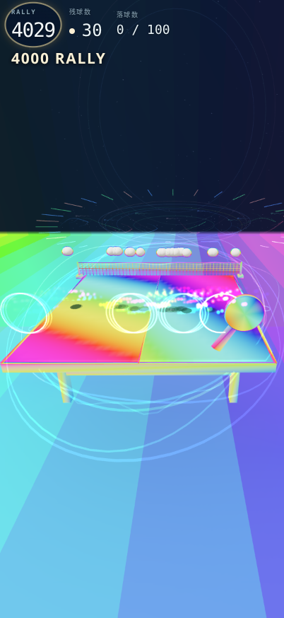
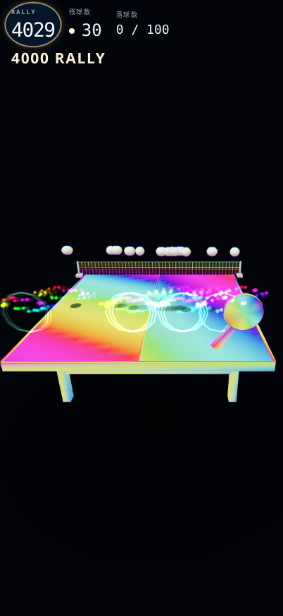
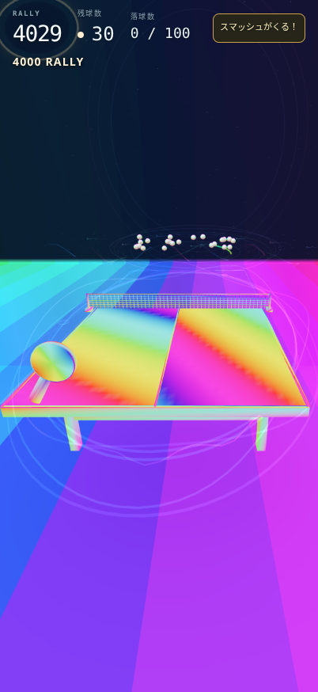
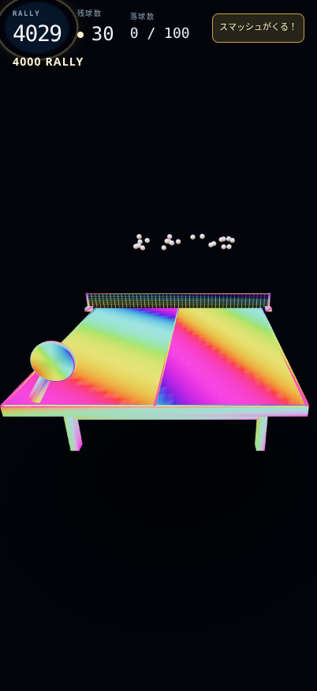
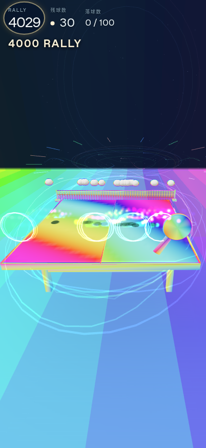
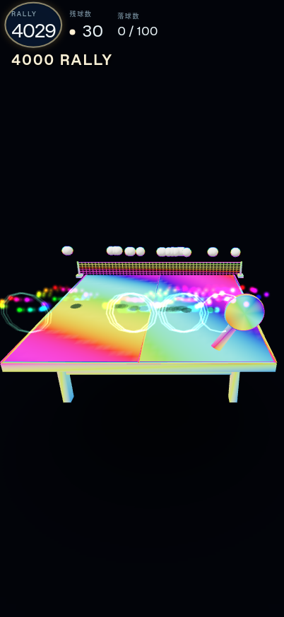

# 視認性・入力・固定資源の最終検証

対象sourceは`b0b6760610c17dc5a1f19efebf42049a31df1150`、比較元は`6ec38720b4f720c71bf48c5aef3cdc5732fdd578`。最終版は標準/低画質の固定2モード。自動画質を不採用にしたため、配布版でプレイ中に画質が切り替わる経路はない。[候補の不採用理由](stage2-rejection.md)。

## ボールと警告

Chromium156/SwiftShader、WebKit27.2でCSS402×874/DPR2を使った。同一の縦横比で保存し、横長画像を縦長へ変形していない。標準buffer603×1311、低画質402×874。撮影は内容の比較用で、実時間性能の証拠として使わない。

| 検査 | 対象 | 結果・範囲 |
|---|---|---|
| 固定状態 | 500/1000/1500/2600/3000/4000、通常/重複/花火、両モード/両engine、144枚 | 72比較で状態/球/ラケット一致。白中心96サンプル（incoming48/outgoing48）、最小229 |
| 実物理の連続画像 | 3999→4000→以後、30球、両モード/両engine、各375frame | 前後3000枚、1500フレーム対。snapshot/演出事実/event/投影位置/警告/通知/CSS/実RAF一致 |
| 実物理の白中心 | 各variant58点（incoming31/outgoing27）、計232点 | 最小230。各variantで106frameの実スマッシュ警告も確認 |
| GL寸法 | viewport/bufferと実際のfield解像度uniform | 静止画像で24uniformサンプル。CSS/カメラと固定モードの既存仕様を維持 |

白中心は**変更前>=220の適格サンプルに対し変更後>=200**という既存基準を変えていない。投影した保守的な球シルエットが重なる点、画面外/非表示phaseは判定から除外し、除外数も保存した。静止画像720点、実物理は各variantで画面外等2970・重複8222点を除外している。30球すべてが常時一個ずつ分離して見えることや、人間にとっての快適さを保証する検査ではない。

正式記録：`manual-render/comparison-summary.json` と `manual-render/comparison.json.gz`、`manual-native/comparison-summary.json`、各engine/side/modeの`capture.json.gz`とlossless動画。8本の375frame動画は全decoded RGBのSHA256が元画像と一致した後で原PNGを整理し、代表6frameを残した。PNGの圧縮コンテナ自体を再現する保証ではない。

## ネイティブ入力と復旧

標準/低画質×両engineの8テストを実行した。Playwrightのブラウザ入力APIによる`isTrusted`なmouse/pointer captureとtouchscreenを使い、中央・左右上下端・指を離さない9点連続drag、5点touch、回転、pause/resume、実際の`WEBGL_lose_context`喪失/復旧、retry後を確認した。期待座標は製品のmapping関数を呼ばず、カメラのunprojectとray-plane交点から独立計算した。

116座標の最大CSS誤差は**0.731554651px**（Chromium約0.00000459px、WebKit0.731555px）。全点が元の**1px以内**で、再開後も操作できた。最終版には画質切替がないため、切替中dragの合格を配布版の実績として数えない。不採用候補9a9の切替機能検査と区別する。物理iPhoneや実際の指の操作感は未確認。

正式記録：`manual-native-input.{json,log}`、`manual-native-input-derived.json`、runnerとconfig、全失敗traceを含む正式アーカイブ。

## 資源・メモリ

全4実行（A/F×両engine）で、5warm・20retry・5view.dispose/recreateを検査した。再生成時は毎回0ラリーから同一順序で4000/100落球まで準備する。最初のbaseline試行は初回だけ4000から作ったためshader program数が17→13になり、同値検査が失敗した。この方法不一致、元runner/logと修正理由を残し、回数・同値キー・閾値を維持して全4実行をやり直した。修正後はGPU資源の固定数が安定した。

| Chromium標準/縦画面 | A | 最終F |
|---|---:|---:|
| geometry数 |39|32|
| forced-GC JS used最初→20retry後 bytes |10,520,976→10,949,820|10,117,352→10,485,156|
| backing-store bytes（同一実行内で一定）|10,384,452|9,679,629|
| 新rally batch typed-array確保 bytes |1,720,320|1,133,664|

rally描画属性のtyped-arrayは586,656bytes減った。一方で厳密な重複照合用Int16Arrayを2KiB追加しており、この表は総CPUメモリやVRAMではない。JS usedはAで428,844bytes、Fで367,804bytes増えており、JIT/キャッシュ/fixtureの寄与は未分離。**全メモリ増加なし・リークなしとは断定しない。** WebKitの正確なheap値は取得できずnullのまま記録する。実時間ベンチのheapには検査用event journal/collectorも含むため、製品単体メモリとは区別する。

正式記録：`manual-resource-audit/`、`manual-resource-audit-initial-unequal-warmup/`、`resource-audit-correction.json`。20retryの資源安定と5分実時間の継続検査は別々の範囲であり、無制限の長時間安定性を保証しない。

実時間ベンチの`performance.memory`は丸められた粗い値で、同じ値が続いても無増加の証明にしない。上のforced-GC表は別の`Runtime.getHeapUsage`による観測である。

## 同じ実物理フレームの代表画像

全てnative CSS402×874。前後でball/paddle/state/実RAFが一致する。PNGは代表保存時に再圧縮されるため、元PNGコンテナのbytes一致は主張しない。全動画の無損失RGB検証に加え、代表6枚それぞれを動画の指定frameからdecoded RGBで再照合した。[各画像のSHA256・frame・video証明](images/provenance.json)。

| 条件 | 開始時A | 最終版 |
|---|---|---|
| Chromium標準、frame60、4000到達後/30球 |  |  |
| Chromium標準、frame125、実スマッシュ警告中 |  |  |
| WebKit低画質、frame60 |  |  |
