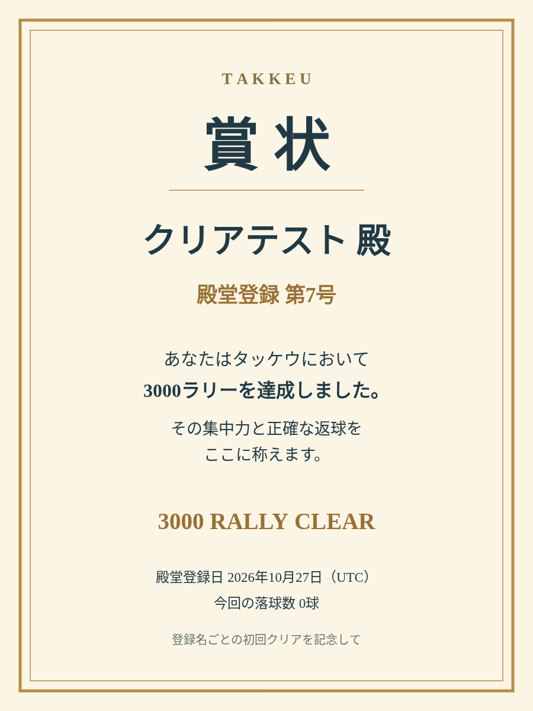

# 3000ラリークリア・殿堂入り

3000ラリー目の返球でゲームクリアとし、得点・物理を止め、静かな結果画面へ移る。登録名ごとの初回クリアにサーバーが「殿堂登録 第○号」を割り当てる。同名の再クリアは同じ番号・初回日付を使う。旧スコアは保持し、過去記録への番号付与は行わない。

**Draft。本番DBへ新SQLを適用せず、mainへマージせず、公開ページも更新していない。**

最終コード `720c06357beff5e7bdfe0073fb35293c7f45b372` のPR/push CIはいずれも全6job成功。単体942件・Chromium/WebKit計218件・配布物8件の計1168条件が成功した。実機の快適さを保証する結果とは区別する。

|項目|実装・検証|
|---|---|
|ゲーム|3000ちょうどでclear。30球同時返球、終端競合、失敗との区別、終了後freezeを検証|
|操作・難易度|3000未満の物理・入力・増球・最大30球・固定刻みを維持。描画解像度の手動設定も維持|
|殿堂|新開始/終了の印、送信済みスコア照合、同名一意、counter行ロック採番、対象外名の公開除外|
|互換性|旧4001点などのpendingを元のclientVersion/APIで再送。匿名回数queueも旧契約を維持|
|賞状|結果画面で要求時に900×1200 PNGを生成。番号・名前・初回登録日（UTC）。名前なしは番号なし|
|終了音|3Dを止めても3000ファンファーレは鳴り終える。中断・ホーム・再挑戦は停止|
|安全性|クリア後の2ブラウザー×360フレームは元の解析で点滅閾値超過なし。以前の警告の解消とは区別|
|反復|両ブラウザー各5回warmup＋20回のクリア/PNG/ホーム/再挑戦で描画資源・URL保持を確認|

- [仕様と実装方針](../../superpowers/specs/2026-10-27-goal-3000-design.md)
- [正式検証・修正とCI](validation.md)
- [性能・ゲーム時間・メモリ・安全性](measurements.md)
- [適用前提と公開手順](deployment.md)
- [独立設計レビュー](builder-review.md)、[SQL監査](sql-review.md)、[クライアント監査](client-review.md)、[全体レビュー](final-review.md)
- [実装台帳](progress.md)、[保護したソースのハッシュ](source-protection.json)
- [正式証拠の完全復元](evidence-method.md)、[独立証拠監査](evidence-review.md)、[記録commitのsource同一性](record-only-provenance.json)、[未解決事項](unresolved.md)
- [以前の描画整理と完全な旧証拠](../adaptive-rendering/README.md)

実装コミットは `996b1e2`（main628統合）、`cc5f8be`（3000終端）、`6794418`（DB）、`e2e8379`（UI/再送/賞状）、`93294e8`（共有応答の所有権）、`720c063`（DB試験の最終サーバー待ち）。製品コードは93294e8で固定し、720c063は試験用起動処理のみを変更した。

画像は模擬応答の「クリアテスト・第7号」。本番の殿堂記録ではない。PNGは元の比率を維持している。

[Chromiumの結果画面](images/clear-chromium.png) / [WebKitの結果画面](images/clear-webkit.png) / [WebKitの賞状](images/certificate-webkit.png)

3000で終わることは、3000未満のフレーム性能改善の証明ではない。既存Linux目標は旧検証で未達。新ルールの実機性能・操作感、実機音声/画像共有/HDR、正式なWCAG適合は未確認。以前の点滅警告を解消済みとしない。
