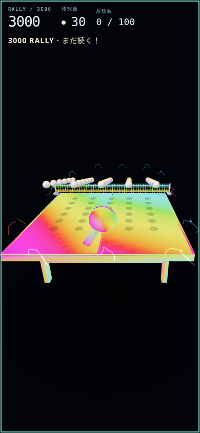
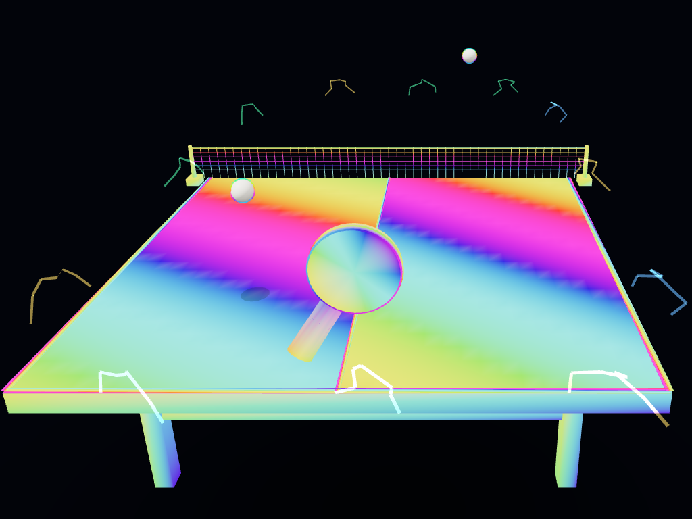

# 3500ラリー変更の検証

- Stage A: `4bc1477` — 3500終端・3000継続・共通bufferの一時電撃・1500以降の通常feedback停止・独立表示時計。
- Stage B: `63d972c` — 新3500契約、旧3000/従来pending、殿堂台帳分離、賞状と共有。
- Stage C: `fdbdf46b9d8b846db200a2895cf73a73f8e2f02d` — browser/SQL競合/20 retryと性能runner。

本番SQLは未適用。マージ・Pages公開は実施しない。過去の検証文書は当時の旧3000/4000仕様の履歴であり、新ルールの説明ではない。

実60秒の性能測定は `tests/helpers/measureGoal3500.mjs ROOT DEST`。開始555、実時計、通常fixed-step、30球、autoplayによる入力のみ。速度/step/遅延停止を改変しない。標準/低負荷、Chromium/WebKit。p95<=25ms、95%以上<=25ms、sim進行59秒以上・30球連続の従来Linux基準を保つ。

別途 `captureGoal3500.mjs ROOT DEST` は1500/2600/3000/3250/3499/3500の30球の固定姿勢と節目の描画負荷を比較する。render+readback+PNG encode時間であり、実プレイfpsとは別。点滅は同じ旧解析器 `rallyFlashAnalysis.py` を変更せず使用する。3.2秒×60Hz、1024×768 SDR/sRGB、3000/3500/3200+loss100/3000+loss99、両画質の比較。人の視認・実機・HDR・正式適合は別途確認が必要。

最終結果と制限は [results.md](results.md)、実60秒測定は [performance.md](performance.md)、独立監査は [final-audit.md](final-audit.md)、全frameを含む証跡の復元は [evidence-method.md](evidence-method.md)、本番適用の前提は [deployment.md](deployment.md) を参照。

これは描画fixtureの静止画であり、実60秒測定や実機操作の代替にはしない。
